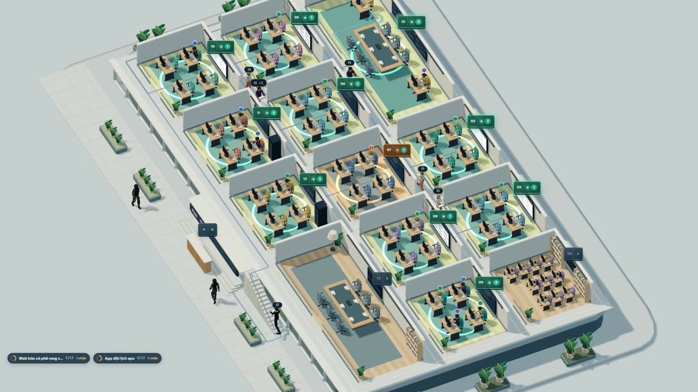
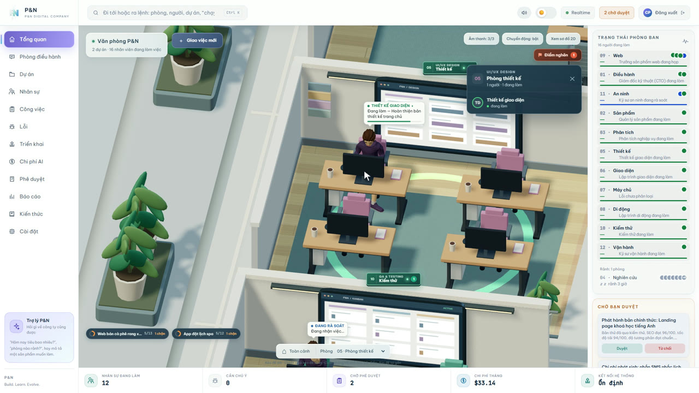
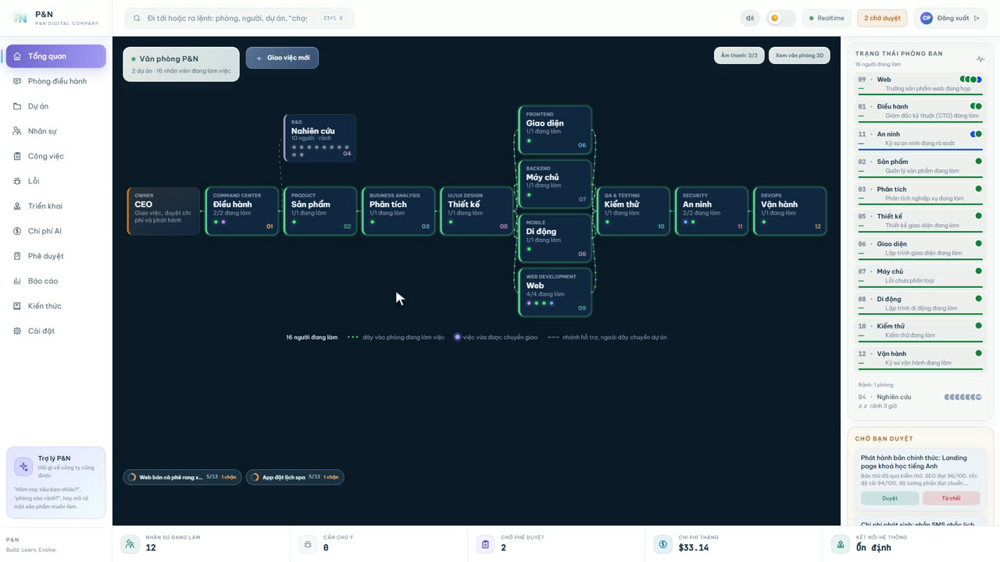
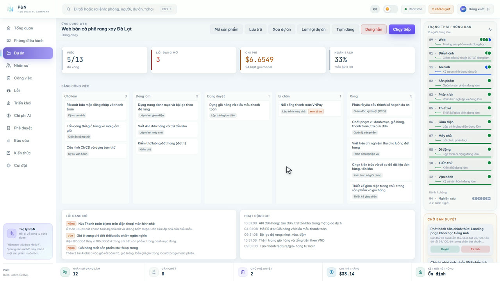
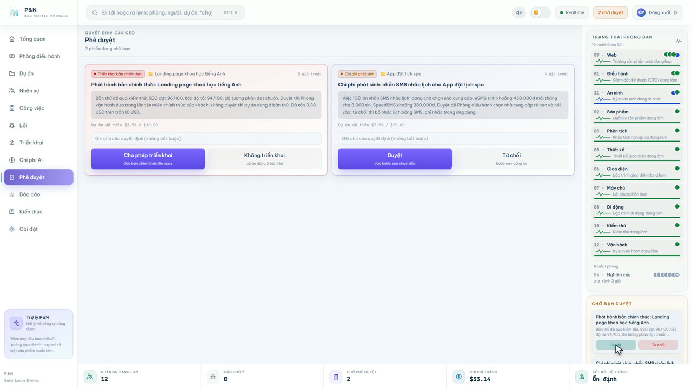

# P&N

> **Build. Learn. Evolve.** — *Xây dựng. Học hỏi. Tiến hóa.*

Nền tảng vận hành như một công ty phần mềm AI thu nhỏ: CEO giao việc, các AI
Agent đảm nhiệm toàn bộ vòng đời **Ý tưởng → Phân tích → Kiến trúc → Thiết kế →
Code → Test → Security → Deploy → Báo cáo**.

Hai lớp giao diện:

- **Telegram Bot** — remote control: giao việc, duyệt quyết định, xem trạng thái.
- **Web Dashboard 3D** — control room: văn phòng sống động, digital twin của
  trạng thái agent thật.

Đặc tả đầy đủ: [AI_SOFTWARE_COMPANY_PROJECT_SPEC.md](AI_SOFTWARE_COMPANY_PROJECT_SPEC.md)
(150 mục). Kế hoạch thi công: [IMPLEMENTATION_PLAN.md](IMPLEMENTATION_PLAN.md).

**Cài trên máy Windows (không cần biết lập trình): xem [HUONG-DAN-CAI-DAT.md](HUONG-DAN-CAI-DAT.md).**
Cài cho người phát triển: xem [SETUP.md](SETUP.md).

```bash
git clone https://github.com/nguyentannhanit/pn-company.git
cd pn-company
```

---

## Trạng thái

| Phase | Nội dung | Trạng thái | Đã có |
|---|---|---|---|
| 0 | Foundation & repo skeleton | ✅ Hoàn tất | Monorepo, kiểu dữ liệu chung, event, PostgreSQL, quyền |
| 1 | MVP end-to-end (§35, §87) | ✅ Hoàn tất | Giao việc → CTO chia task → code trong sandbox → test → báo cáo |
| 2 | Full agent org + 3D office (§36) | ✅ Hoàn tất | 12 phòng ban 3D + phòng họp, người đưa việc đi giữa các phòng, cổng duyệt production, Phê duyệt, Báo cáo, Docker sandbox, Telegram báo chủ động |
| 3 | Digital product company (§37, §91–97) | 🟢 Gần xong | Định tuyến theo loại sản phẩm, phòng Web (SEO, tốc độ, dễ tiếp cận), Red Team, tự chọn model + dự phòng hãng. Còn thiếu lập lịch đa dự án |
| 4 | Knowledge & R&D (§98–146) | 🟢 Gần xong | 10 agent tri thức, khám phá hằng ngày, sàng lọc chèn prompt, thử trong sandbox, cấp độ/XP, khôi phục, phòng R&D 3D. Còn thiếu knowledge graph |
| 5 | Autonomous + governance (§38, §147–149) | 🟡 Đang làm | Chặn tự sửa chính sách và tự cấp quyền, production luôn qua duyệt, tự dựng bản thử. Vòng tự trị trọn vẹn chưa xong |

## Ảnh chụp

Ảnh chụp từ hệ thống chạy với **dữ liệu mô phỏng**.



| | |
|---|---|
|  |  |
| Bấm vào phòng xem từng người đang làm gì | Sơ đồ 2D: mỗi chấm sáng là một việc đang chạy |
|  |  |
| Bảng việc của dự án, lỗi đang mở, hoạt động Git | Bước quan trọng như phát hành chờ CEO duyệt |

## Bắt đầu

```bash
npm install
cp .env.example .env

# sinh master key cho secret store (§69) và secret dịch vụ giữa các tiến trình
node -e "console.log(require('crypto').randomBytes(32).toString('base64'))"

npm run verify                # typecheck + lint + test
npm run db:migrate            # cần DATABASE_URL trỏ tới PostgreSQL

npm run dev:api               # API + AI Gateway + WebSocket, cổng 4000
npm run dev:web               # Dashboard, cổng 3000
npm run dev:bot               # Telegram Bot (cần PN_SERVICE_SECRET)
```

Mở http://localhost:3000 — lần đầu sẽ hiện màn hình **Welcome to P&N** để tạo tài
khoản CEO, sau đó vào **Cài đặt** nhập API key provider và tạo bảng định tuyến.

## Scripts

| Lệnh | Việc |
|---|---|
| `npm run typecheck` | `tsc --build` toàn monorepo |
| `npm run lint` | ESLint, 0 warning |
| `npm test` | Vitest |
| `npm run verify` | cả ba, dùng trước khi đóng mỗi phase (§40.6) |
| `npm run db:migrate` / `db:status` | Migration PostgreSQL |
| `npm run dev:api` / `dev:web` / `dev:bot` | Chạy từng tiến trình ở chế độ phát triển |
| `npm run build:web` | Build dashboard |
| `npm run format` | Prettier |

> **Lưu ý môi trường:** tên thư mục chứa ký tự `&`, mà `cmd.exe` trên Windows
> hiểu là dấu phân tách lệnh — mọi shim trong `node_modules/.bin` (kể cả `npx`)
> sẽ lỗi. Các script đã gọi thẳng entrypoint qua `node` nên chạy bình thường.
> Nếu muốn dùng `npx`, clone vào thư mục không có `&` (mặc định `pn-company` đã đúng); thương hiệu hiển
> thị vẫn là **P&N** vì đọc từ `packages/shared/branding.ts`.

## Cấu trúc

```text
apps/         web · api · telegram-bot · worker
packages/     shared · events · database · llm · permissions
              secrets · sandbox · agents · orchestrator · ui · three-office
infrastructure/  docker · github-actions
docs/         ARCHITECTURE · DATABASE_SCHEMA · SECURITY · AGENTS
```

## Tài liệu

- [docs/ARCHITECTURE.md](docs/ARCHITECTURE.md) — kiến trúc, luồng dữ liệu, quyết định kỹ thuật
- [docs/DATABASE_SCHEMA.md](docs/DATABASE_SCHEMA.md) — 41 bảng theo §14, §44–56, §130
- [docs/SECURITY.md](docs/SECURITY.md) — secret, RBAC, sandbox, audit
- [docs/AGENTS.md](docs/AGENTS.md) — bộ agent, workflow, state machine, routing

## Quy ước code

- Comment trong code và SQL viết **tiếng Việt**; tên biến/hàm/kiểu giữ tiếng Anh.
- Mỗi hàm hoặc khối có chú thích ngắn nêu mục đích, kèm dẫn chiếu mục spec.
- Không comment kiểu thuật lại code; chỉ giải thích *vì sao*.

## Nguyên tắc không thương lượng

1. Không hard-code secret, không trả raw secret ra API hay Telegram (§19, §89).
2. Mọi request AI đi qua backend AI Gateway (§89).
3. Không hard-code vendor model (§15).
4. Agent chỉ có quyền tối thiểu (§20).
5. Animation 3D chỉ phản ánh dữ liệu thật (§9).
6. Production deploy luôn qua phê duyệt (§20, §38).
7. Không fake implementation (§40.10).
8. Tên công ty luôn là **P&N** (§150).

## Giấy phép

MIT — xem [LICENSE](LICENSE). Mô hình 3D nhân vật của Quaternius, ghi công ở
[apps/web/public/models/GHI-CONG.md](apps/web/public/models/GHI-CONG.md).
